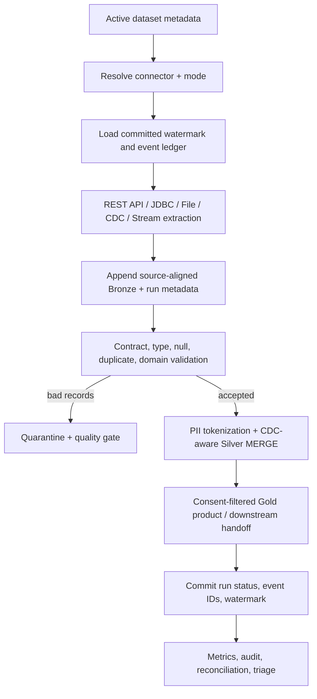

# Patient Services Lakehouse Platform

A metadata-driven ingestion platform blueprint for Salesforce Patient Management Services and adjacent healthcare data sources. The implementation focuses on reusable ingestion controls, operational state, contract validation, CDC replay, governed curation, and an optional Spark/Delta sink. All bundled records are fictional synthetic data.

## Platform capabilities

- Generic ingestion orchestration driven by versionable dataset metadata.
- Connector registry for REST API, JDBC/DB-API, CSV/JSON/JSONL files, CDC envelopes, and bounded streaming micro-batches.
- Salesforce-style CDC example with `SystemModstamp`, operation events, event identity ledger, and per-dataset control watermark.
- Bronze append, metadata enrichment, quarantine, schema/null/type/duplicate/domain validations, reject thresholds, and replay-safe Silver merge semantics.
- Consent-aware Gold product publication and HMAC tokenization of configured identifiers.
- Transactional run and watermark control store, audit artifacts, reconciliation, duration/count metrics, and a read-only operations triage agent.
- Optional PySpark/Delta Lake MERGE sink alongside a local JSONL sink used for deterministic development and CI.
- Azure-oriented architecture mapping, Terraform storage scaffold, container build, and GitHub Actions CI.

## Quick start

Python 3.11+; the local runtime uses only the standard library.

```bash
python -m pip install -e .
patient-lakehouse demo --output ./build/demo
```

This generates synthetic CDC events and executes the configured pipeline. Inspect `build/demo/lakehouse` for Bronze, Silver, Gold, quarantine, control database, and per-run quality/audit/reconciliation artifacts.

Run the test suite:

```bash
python -m unittest discover -s tests -v
```

Generate a fixture separately and run a metadata entry:

```bash
patient-lakehouse generate --output ./build/input --patients 250 --days 14 --seed 42
export PMP_CDC_FIXTURE="$PWD/build/input/pmp_cdc.jsonl"
export PII_HMAC_KEY="inject-from-a-secret-manager-in-real-environments"
patient-lakehouse run --dataset pmp_patient_services --state-dir ./build/lakehouse
patient-lakehouse diagnose --run-dir ./build/lakehouse/runs/<run-id>
```

The demo command uses a fixed demonstration-only HMAC key. Production execution requires a managed secret configured as `PII_HMAC_KEY`; do not use a shell literal in a real environment.

## Execution flow



Operational rules are deliberate: a failed quality gate or downstream handoff does not advance the watermark; quarantined incremental records remain eligible for replay; committed CDC event IDs are kept in a ledger; Silver state merges are idempotent by business key; and the checkpoint is committed only after the downstream handoff succeeds.

## Repository map

```text
src/patient_lakehouse/       engine, metadata model, connectors, sinks, controls, monitoring
config/metadata/             active dataset definitions
config/examples/             inactive API, JDBC, file, and streaming metadata patterns
infra/                       illustrative Azure Terraform scaffold
tests/                       connector contracts and synthetic integration tests
docs/                        architecture, controls, production rollout, interview walkthrough
```

## Production boundary

The local control store and JSONL sink make behavior executable without cloud credentials. `DeltaLakeSink` provides Spark DataFrame writes and Delta `MERGE` operations when PySpark and Delta Lake are installed. The JDBC connector uses an injected DB-API driver and parameterized queries; the REST connector uses bounded pagination, bearer-token environment injection, timeout, retry/backoff, and throttling-friendly request boundaries. The CDC and streaming connectors in the local profile read fixtures; production Event Hubs/Kafka sources should implement the same connector protocol with durable offsets and checkpointing.

The Terraform scaffold is not a production landing zone. The project does not claim GxP validation or HIPAA/GDPR compliance. Before real patient data, apply the applicable privacy basis and consent rules, retention/deletion policy, Unity Catalog permissions and masking, Entra/managed identity, private networking, Key Vault, lineage, validated SDLC, and security review.

See [architecture and design](docs/architecture.md) and [principal engineer walkthrough](docs/interview-guide.md).
