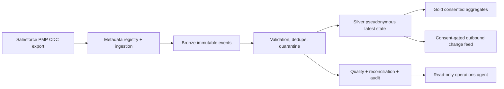

# Architecture and production evolution

## Flow

## Key decisions

- **Idempotency:** event IDs are the ingestion ledger key. A production implementation should persist this ledger transactionally in Delta and handle late events with event-time watermarks.
- **Schema evolution:** required and enumerated values are configuration-controlled; incompatible rows are quarantined with stable reason codes. Additive changes should require contract review and compatibility tests.
- **Privacy:** direct IDs are HMAC-tokenized before the curated layer. Consent is evaluated before the outbound change feed. This sample's per-run secret makes tokens non-linkable across runs and is not a production key strategy.
- **Bidirectional sync:** outbound rows carry a deterministic idempotency key. A real Salesforce Bulk API worker would add OAuth via Key Vault, rate-limit budgeting, retry/backoff, dead-letter handling, and source-target reconciliation before checkpoint advancement.
- **Agent controls:** the agent can read only three run artifacts, emits recommendations, and cannot invoke mutation tools. Production orchestration should require scoped identity, explicit tool allowlists, human approval for remediation, trace/evaluation records, and prompt-injection defenses.
- **Observability:** quality and reconciliation outputs are explicit gates; metrics and audit artifacts support operational triage. A production service would export structured metrics/traces and alert on freshness, volume drift, rejection rate, API limits, and stuck watermarks.

## Azure mapping

| Concern | Local example | Azure / Databricks candidate |
|---|---|---|
| Landing | JSONL | ADLS Gen2, Event Hubs, ADF/API copy |
| Transform | Python | Databricks Jobs, PySpark, Delta Lake |
| Governance | JSON contract | Unity Catalog, Entra groups, row/column controls |
| Secrets | ephemeral run key | Key Vault + managed identity |
| CI/CD | GitHub Actions | Actions or Azure DevOps, Terraform/Bicep, Asset Bundles |
| Salesforce | fixture and outbound CSV | Bulk API / REST / platform events with throttling |

The Terraform directory intentionally provisions only a minimal storage account and container as an illustrative scaffold. Networking, private endpoints, identity, diagnostic settings, policy, encryption configuration, and environment state must be designed for the target organization before deployment.
